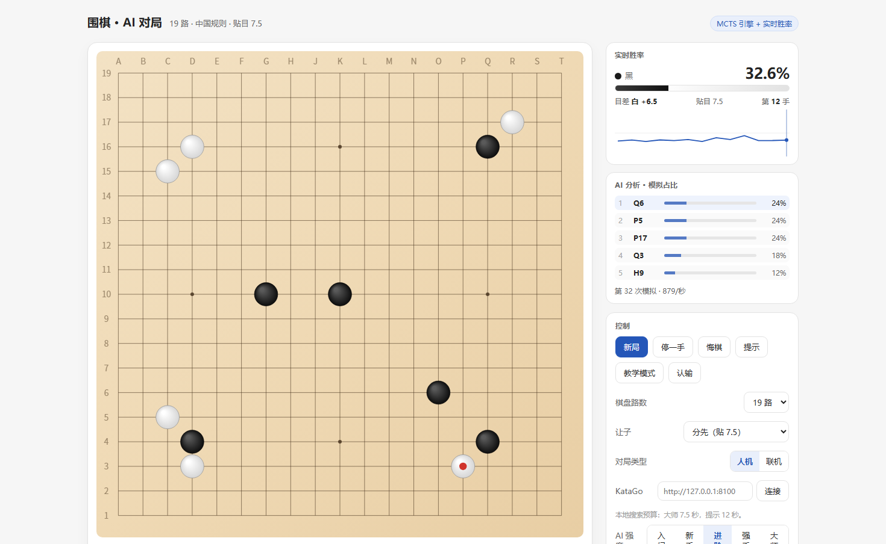

# Weiqi · AI opponent with a live win-rate chart

Play Go in the browser: a local AI opponent, a live win-rate curve, teaching hints, SGF records and endgame scoring. Pure front end, no runtime dependencies, works offline and makes no network requests.

[简体中文](README.zh-CN.md) · **[Play the demo](https://hhxx6666.github.io/weiqi-ai/)** · [MIT](LICENSE) · Node.js 20+ (development only)



## Features

| | |
| --- | --- |
| **Play** | 9×9, 13×13 and 19×19 boards. The AI answers every move, and you can hand it Black so it opens the game |
| **Win rate** | A live win-rate chart; click a point on the curve to jump to that move |
| **Teaching** | With teaching on, every turn is analysed and the recommended point is marked with a short explanation. Practice mode lets you guess first, then compares your pick with the AI's first choice and the opponent's likely reply |
| **Endgame** | After both sides pass twice in a row you move to counting. Click stones to mark or unmark dead groups, then confirm the result — Chinese area scoring with White's komi. Resigning works mid-game too |
| **Records** | SGF import and export, plus step-by-step review. Import follows the main line, and on a branch it takes the first variation |
| **Resume** | The game autosaves in the browser; return to the same URL to pick it up again |
| **Boost** | Optionally connect KataGo to lift the strength from amateur to professional |

## Quick start

**Just play**: download the repository and open `index.html` in a browser. It is a single file with all scripts and styles inlined — no server needed.

**Develop locally**:

```sh
cd src
npm start
```

The terminal prints the address, `http://127.0.0.1:8080/` by default, and picks another port if that one is taken. The project only uses Node.js built-in modules, so there is no `npm install`.

## Layout

```text
index.html            Single-file build, also the GitHub Pages entry point (do not edit)
src/index.html        Development entry point
src/go-engine.js      Rules, MCTS and win-rate evaluation. window.GoEngine in the browser, require in Node
src/winrate-panel.js  Win-rate panel; mount() it into any container
src/go-record.js      SGF read and write
src/go-ending.js      Dead-stone marking and endgame counting
src/katago-bridge.js  Optional KataGo analysis bridge
src/katago-server.js  Optional local KataGo HTTP service
src/mock-katago.js    Simulated process used by the bridge tests
src/preview-server.cjs   Local preview server
src/build-standalone.cjs Bundles src/ into the single-file page at the repository root
src/test-*.js         Test scripts
```

`index.html` is a build artifact. Make every change in `src/` and rebuild:

```sh
cd src
npm run build
```

CI rebuilds the page, compares it with the committed `index.html`, and fails when the artifact is stale.

## Tests

```sh
cd src
npm test
```

Five suites, each also runnable on its own:

| Command | Coverage |
| --- | --- |
| `npm run test:engine` | Rules, captures, suicide, saving groups, counting — 14 cases |
| `npm run test:hints` | Hint cancellation, stale responses, fallback and teaching notes |
| `npm run test:record` | SGF import/export and malformed records |
| `npm run test:ending` | Dead-stone marking helpers and counting |
| `npm run test:katago` | Bridge protocol, driven by a simulated process |

## Optional: connect KataGo

The built-in engine works out of the box. For stronger play, get a KataGo build and a `.bin.gz` network that match your machine, plus an analysis config, then start the bridge from `src/`:

```sh
# Windows PowerShell
$env:KATAGO_BIN  = 'C:\KataGo\katago.exe'
$env:KATAGO_MODEL = 'C:\KataGo\network.bin.gz'
$env:KATAGO_CFG  = 'C:\KataGo\analysis.cfg'
node katago-server.js
```

```sh
# macOS / Linux
KATAGO_BIN=/path/to/katago \
KATAGO_MODEL=/path/to/network.bin.gz \
KATAGO_CFG=/path/to/analysis.cfg \
node katago-server.js
```

Start the preview in another terminal, enter `http://127.0.0.1:8100` in the game's KataGo field and click **Connect**. `/health` only proves the bridge is listening; real strength is confirmed when a hint shows a **KataGo suggestion**.

- [KataGo releases](https://github.com/lightvector/KataGo/releases)
- [Official networks](https://katagotraining.org/networks/)
- [Example analysis config](https://github.com/lightvector/KataGo/blob/master/cpp/configs/analysis_example.cfg)

## Known limits

- The built-in engine plays at amateur strength. It is fine for practice and review, not for professional play. Connect KataGo if you need more.
- Opening `index.html` by double-clicking it hits differing browser behaviour around local file storage, so autosave may not resume. Use `npm start` for reliable resume.
- Dead stones are marked by hand at the end — they are not detected automatically.
- The "online" toggle only switches how hints are displayed. Playing another person across devices needs a room service of its own.
- The bridge and the preview server only listen on `127.0.0.1`.

## License

[MIT](LICENSE)
