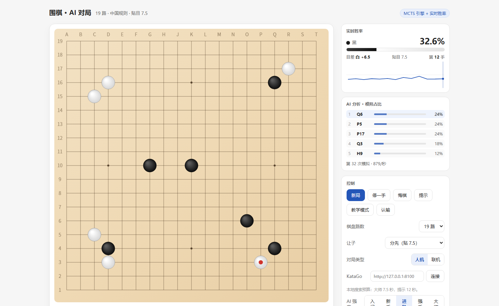

# 围棋 · AI 对局与实时胜率

在浏览器里下一局围棋：本地 AI 对手、实时胜率曲线、教学模式、SGF 棋谱和终局数子。纯前端，零运行时依赖，可离线打开，不发任何外部请求。

[English](README.md) · **[在线试玩](https://hhxx6666.github.io/weiqi-ai/)** · [MIT](LICENSE) · Node.js 20+（仅开发时需要）



## 功能

| | |
| --- | --- |
| **对弈** | 9 / 13 / 19 路棋盘，落子后 AI 自动应手，可切换让 AI 执黑先行 |
| **胜率** | 显示黑方胜率估算及来源，点击曲线上的记录跳到对应手数 |
| **教学** | 开启后每轮自动分析，标出推荐落点并给出简短说明；练习模式先让你试选一手，再对比自己选点、AI 首选和对手可能的应手 |
| **终局** | 双方连续停一手后进入数子，点击棋子可标记或恢复死棋，按中国规则数子并计入白方贴目；对局中也可认输 |
| **棋谱** | SGF 导入导出，逐手复盘；导入读取主线，遇到分支沿第一条变化读取 |
| **续局** | 对局自动保存到浏览器，回到同一地址可继续上次对局 |
| **增强** | 可选接入 KataGo，把棋力从业余水平提到职业水平 |

## 快速开始

**直接试玩**：下载仓库，用浏览器打开根目录的 `index.html`。它是单文件版本，脚本和样式全部内联，不需要服务器。

**本地开发**：

```sh
cd src
npm start
```

终端会打印地址，默认 `http://127.0.0.1:8080/`，端口被占用时自动换一个。项目只用 Node.js 内置模块，不需要 `npm install`。

## 目录结构

```text
index.html            单文件构建产物，也是 GitHub Pages 的入口（勿直接编辑）
src/index.html        开发入口
src/go-engine.js      规则内核 + MCTS + 胜率评估，浏览器挂 window.GoEngine，Node 用 require
src/winrate-panel.js  胜率面板组件，mount() 挂到任意容器
src/go-record.js      SGF 棋谱读写
src/go-ending.js      死棋标记与终局数子
src/katago-bridge.js  KataGo 分析桥接（可选）
src/katago-server.js  KataGo 本地 HTTP 服务（可选）
src/mock-katago.js    桥接测试用的模拟进程
src/preview-server.cjs 本地预览服务器
src/build-standalone.cjs 把 src/ 打成根目录的单文件页面
src/test-*.js         测试脚本
```

`index.html` 是构建产物，改动一律在 `src/` 里做，然后重新构建：

```sh
cd src
npm run build
```

CI 会重新构建并和已提交的 `index.html` 比对，产物过期会直接失败。

## 测试

```sh
cd src
npm test
```

五组脚本，也可以单独跑：

| 命令 | 覆盖 |
| --- | --- |
| `npm run test:engine` | 规则、提子、禁自杀、救棋、数子，14 项 |
| `npm run test:hints` | 提示取消、过期响应、回退与教学说明 |
| `npm run test:record` | SGF 导入导出与畸形棋谱 |
| `npm run test:ending` | 死棋标记辅助逻辑与数子 |
| `npm run test:katago` | 用模拟进程验证 KataGo 桥接协议 |

## 用固定棋局验证本地引擎

下载并在应用中导入这两份 SGF。蓝色为本地估算，橙色为 KataGo 实际分析过的执子或提示局面。来源切换处断线。导入 SGF 时使用本地引擎重新估算曲线。

| 棋局 | 验证方法 |
| --- | --- |
| [一步提子](examples/capture-in-atari.sgf?raw=1) | 回看第 0 手。测试中本地引擎用 1200 次模拟找到 E6，提走只剩一气的 D6 白子。棋谱记录了这一手。 |
| [收完官子的终局](examples/settled-endgame.sgf?raw=1) | 跳到最后一手。本地估算显示黑方约 41%、白方领先 3.5，棋谱结果显示黑胜 1.5。`node src/test-ending.cjs` 验证黑方 45、白方计贴目后 43.5。 |

## 可选接入 KataGo

本地引擎开箱即用。需要更高棋力时，准备与本机系统和硬件匹配的 KataGo 程序、`.bin.gz` 权重和分析配置，再从 `src/` 启动桥接：

```sh
# Windows PowerShell
$env:KATAGO_BIN  = 'C:\KataGo\katago.exe'
$env:KATAGO_MODEL = 'C:\KataGo\network.bin.gz'
$env:KATAGO_CFG  = 'C:\KataGo\analysis.cfg'
node katago-server.js
```

```sh
# macOS / Linux
KATAGO_BIN=/path/to/katago \
KATAGO_MODEL=/path/to/network.bin.gz \
KATAGO_CFG=/path/to/analysis.cfg \
node katago-server.js
```

另开一个终端运行预览，在棋局的 KataGo 输入框填入 `http://127.0.0.1:8100` 并点击「连接」。`/health` 只表示桥接 HTTP 服务已启动，真实棋力要在点提示后看到「KataGo 建议」才算接通。

- [KataGo 发行页](https://github.com/lightvector/KataGo/releases)
- [官方权重列表](https://katagotraining.org/networks/)
- [分析配置示例](https://github.com/lightvector/KataGo/blob/master/cpp/configs/analysis_example.cfg)

## 已知限制

- 内置引擎是业余水平，够用来复盘和陪练，不是职业棋力。要强棋力请接 KataGo。
- 直接双击 `index.html` 时，部分浏览器对本地文件存储的支持不同，自动续局可能失效。想稳定续局就用 `npm start`。
- 终局的死子需要自己点在棋盘上标记，不是自动判定。
- 「联机」只切换提示的显示方式，跨设备真人对局需要另配房间服务。
- 桥接和预览服务都只监听 `127.0.0.1`，不对外暴露。

## 许可

[MIT](LICENSE)
